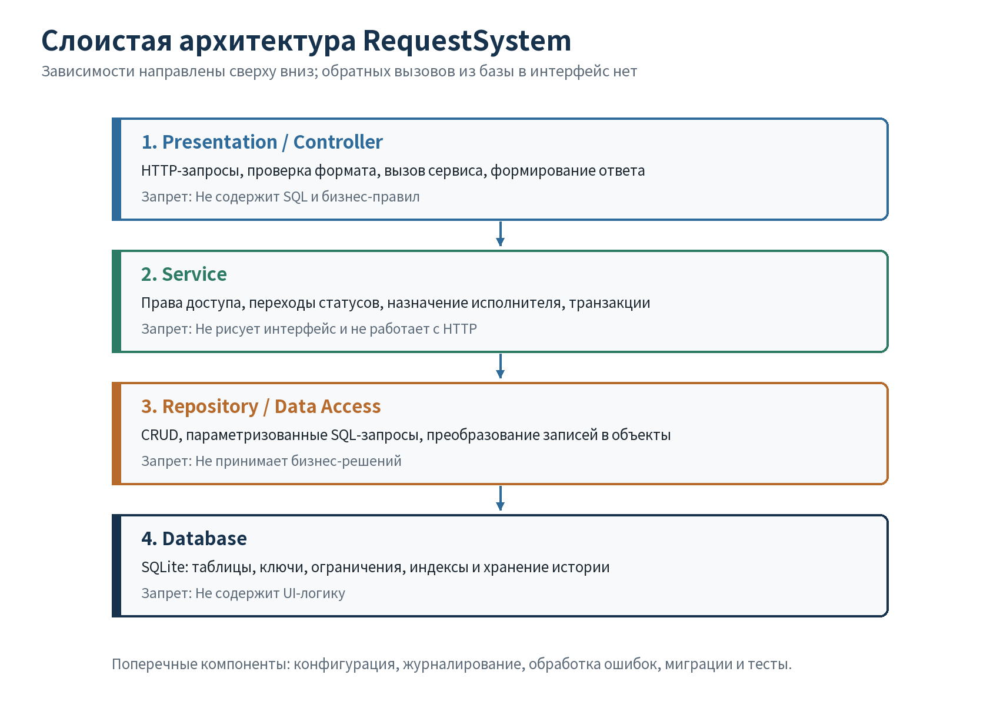
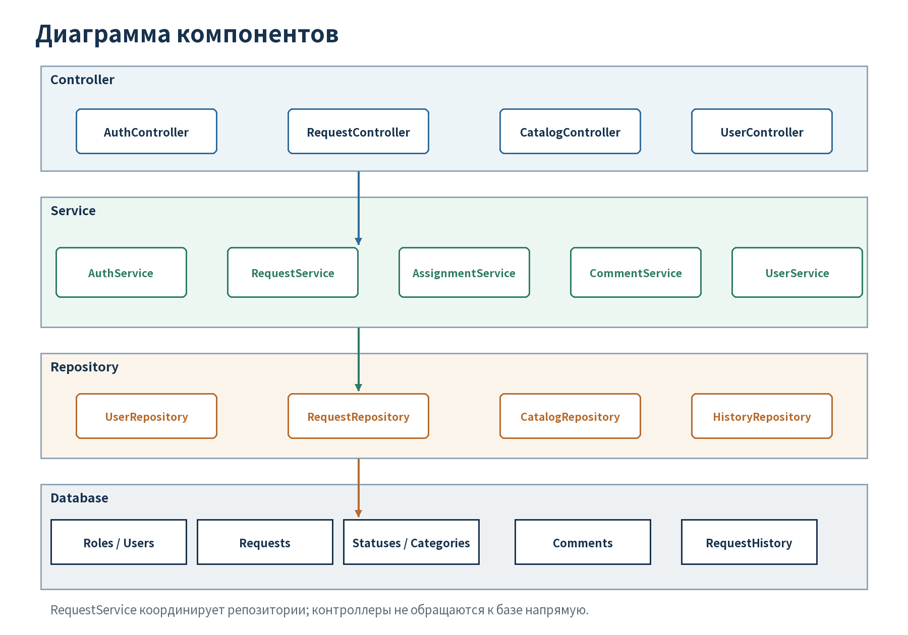

# Проектирование архитектуры RequestSystem

## 1. Исходные требования

Архитектура основана на `docs/TZ.md`. Ключевые ограничения: четыре роли с разными правами, единый жизненный цикл заявки, история изменений, поиск и фильтрация, комментарии, целостность SQLite-базы и возможность повторяемого тестирования.

## 2. Сравнение архитектурных вариантов

| Критерий | Слоистая архитектура | Набор микросервисов |
|---|---|---|
| Простота | Одно приложение и одна база; простой запуск | Нужны сетевые API, развёртывание и согласование нескольких сервисов |
| Тестируемость | Бизнес-правила тестируются отдельно от контроллеров и БД | Требуются компонентные и сетевые интеграционные тесты |
| Расширяемость | Новые функции добавляются в существующие слои | Независимое масштабирование отдельных функций |
| Стоимость внедрения | Низкая для учебного проекта | Высокая: инфраструктура, мониторинг, распределённые ошибки |
| Соответствие проекту | Полностью соответствует небольшой команде и SQLite | Избыточна при отсутствии высокой нагрузки |

**Выбор:** слоистая архитектура `presentation/controller → service → repository/data access → database`.

**Аргументы за:** понятные границы ответственности, низкий порог реализации, удобная проверка бизнес-правил, отсутствие SQL в контроллерах, единая транзакция для статуса и истории.  
**Аргументы против:** при сильном росте системы отдельные модули сложнее масштабировать независимо; при нарушении дисциплины слои могут снова стать связанными. Для учебного проекта эти недостатки менее значимы, чем сложность микросервисов.

## 3. Слои и границы ответственности

| Слой | Ответственность | Что запрещено |
|---|---|---|
| Presentation / Controller | Принять запрос, проверить формат и обязательные поля, извлечь пользователя, вызвать сервис, сформировать ответ | SQL, решения о переходах статусов, прямой доступ к таблицам |
| Service | Проверить роль и владение заявкой, применить жизненный цикл, назначить исполнителя, управлять транзакцией | HTML/UI, HTTP-коды, детали SQLite |
| Repository / Data Access | Выполнить параметризованные CRUD-запросы, поиск, JOIN, преобразовать строки в объекты | Проверка ролей, выбор следующего статуса, формирование экранов |
| Database | Хранить данные, обеспечивать PK/FK, `NOT NULL`, `UNIQUE`, индексы и транзакционную целостность | UI-логика и правила, требующие знания HTTP-запроса |



## 4. Основные модули

- **Auth:** вход, активность учётной записи, получение роли.
- **Users:** администрирование пользователей и ролей.
- **Requests:** создание, поиск, просмотр, редактирование и жизненный цикл заявок.
- **Assignments:** назначение и смена исполнителя.
- **Statuses:** справочник и допустимые переходы.
- **Categories:** справочник категорий и проверка уникальности.
- **Comments:** комментарии участников заявки.
- **History:** добавление и чтение неизменяемой истории.



## 5. Структура исходного кода

```text
src/request_system/
  controllers/
    auth_controller.py
    request_controller.py
    catalog_controller.py
  services/
    status_service.py
    request_service.py
    assignment_service.py
    comment_service.py
  repositories/
    user_repository.py
    request_repository.py
    catalog_repository.py
    history_repository.py
  models/
    request.py
    user.py
  config.py
tests/
  test_status_service.py
  test_database.py
database/
  schema.sql
  seed.sql
  queries.sql
  requests.db
```

Контроллеры зависят от сервисов, сервисы — от интерфейсов репозиториев, репозитории — от соединения с базой. Доменная модель не зависит от контроллеров.

## 6. Ключевые классы и модули

| Класс / модуль | Назначение | Входные данные | Результат |
|---|---|---|---|
| `RequestController` | Обработать запрос создания или изменения заявки | Данные формы/API, идентификатор текущего пользователя | Ответ с карточкой либо понятная ошибка валидации |
| `RequestService` | Проверить доступ и выполнить бизнес-операцию | Идентификаторы пользователя и заявки, изменяемые поля | Обновлённая заявка и запись истории в одной транзакции |
| `StatusService` | Определить допустимость перехода | Текущий и новый статус, роль, наличие исполнителя | `True`/`False` и код причины отказа |
| `RequestRepository` | Сохранять и находить заявки | Объект заявки или параметры поиска | Идентификатор, объект заявки или список строк |
| `HistoryRepository` | Добавлять и читать историю | Заявка, старые и новые значения, автор, дата | Новая запись истории или хронологический список |

## 7. Архитектурное ревью с ИИ

**Модель:** Kimi (Kimi Work); точная версия интерфейсом не сообщается.

**Полный промпт:**

> Выступи архитектурным ревьюером. Проверь слоистую архитектуру учебной системы учёта заявок: controller → service → repository → SQLite. Роли: администратор, оператор, исполнитель, заявитель. Основные модули: пользователи, заявки, статусы, категории, комментарии и история. Изменение статуса и запись истории должны быть одной транзакцией. Найди нарушения разделения ответственности, слишком связанные компоненты и потенциальные проблемы. Для каждого замечания укажи слой, риск и конкретное исправление. Не предлагай микросервисы без доказанной необходимости.

| Замечание ИИ | Моё решение | Результат |
|---|---|---|
| Контроллер не должен сам координировать два репозитория при смене статуса | **Принято / исправлено** | Координация и транзакция перенесены в `RequestService` |
| Проверку роли нельзя выполнять только скрытием кнопок | **Принято** | Проверка назначена сервисному слою; контроллер лишь передаёт пользователя |
| Хранить все переходы статусов только в SQL-триггерах неудобно | **Принято / исправлено** | Матрица переходов вынесена в `StatusService`, БД обеспечивает целостность, но не бизнес-политику |
| Для каждой категории нужен отдельный сервис | **Отклонено** | Это создало бы дублирование; выбран общий `CatalogService` |
| Сервис должен зависеть от реализации SQLite-репозитория | **Принято / исправлено** | В описании слоёв предусмотрена зависимость от интерфейса репозитория, а не от SQL |
| Историю можно перезаписывать при новом изменении | **Отклонено** | Это противоречит FR-09; история только дополняется новыми строками |

## 8. Обоснование результата

Выбранная архитектура непосредственно поддерживает требования: сервисный слой проверяет права и жизненный цикл, репозитории изолируют SQL, база защищает связи, а контроллеры отвечают только за взаимодействие с пользователем. Для ключевого правила переходов создан отдельный модуль, который можно тестировать без интерфейса и базы. Это делает решение достаточно простым и одновременно расширяемым.
