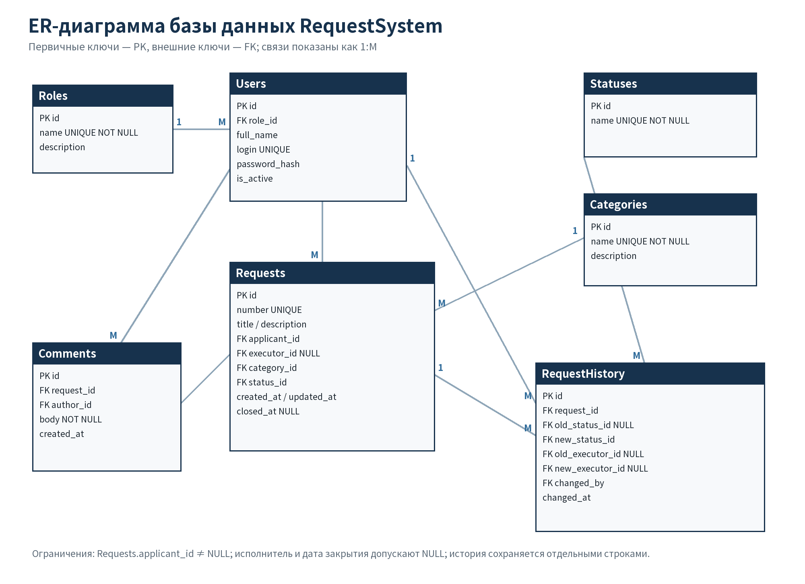

# Проектирование и создание базы данных RequestSystem

## 1. ER-модель

База построена по сущностям из технического задания. Основная сущность `Requests` связана с заявителем, исполнителем, категорией и статусом. Комментарии и история хранятся отдельными записями, поэтому предыдущие значения не перезаписываются.



## 2. Таблицы, ключи и обязательные поля

| Таблица | Первичный ключ | Обязательные поля | Внешние ключи и связи |
|---|---|---|---|
| `Roles` | `id` | `name` | Одна роль → много пользователей |
| `Users` | `id` | `role_id`, `full_name`, `login`, `password_hash`, `is_active` | `role_id → Roles.id` |
| `Statuses` | `id` | `name` | Один статус → много заявок и записей истории |
| `Categories` | `id` | `name` | Одна категория → много заявок |
| `Requests` | `id` | `number`, `title`, `description`, `applicant_id`, `category_id`, `status_id`, `created_at`, `updated_at` | Заявитель и исполнитель → `Users`; категория и статус → справочники |
| `Comments` | `id` | `request_id`, `author_id`, `body`, `created_at` | Много комментариев → одна заявка и один автор |
| `RequestHistory` | `id` | `request_id`, `new_status_id`, `changed_by`, `changed_at` | Много записей → одна заявка; статусы и пользователи → справочники |

Связи M:M не потребовались: у заявки один текущий исполнитель и одна категория. Исполнитель может быть не назначен, поэтому `executor_id` допускает `NULL`. Старые значения исполнителя в истории также могут быть `NULL`.

## 3. Нормализация

- **1НФ:** поля атомарны; имя исполнителя, название категории и статус не хранятся в одном списке.
- **2НФ:** неключевые атрибуты зависят от целого простого первичного ключа каждой таблицы.
- **3НФ:** название роли, категории и статуса вынесены в справочники; в `Requests` хранятся только ссылки, а не дублирующиеся названия. Имя заявителя не повторяется в заявке.

История не является нарушением нормализации: она фиксирует факты изменений во времени, а не дублирует текущее состояние ради удобства отображения.

## 4. Ограничения и удаление

- `UNIQUE`: логин, номер заявки, названия роли, статуса и категории.
- `NOT NULL` и `CHECK`: обязательные поля, непустые тема/описание/комментарий, допустимые статусы и активность пользователя.
- `ON DELETE RESTRICT`: нельзя удалить используемую категорию, заявителя или связанные справочники.
- `ON DELETE SET NULL`: при удалении исполнителя текущая заявка сохраняется без назначения.
- `ON DELETE CASCADE`: комментарии и история удаляются вместе с заявкой; это отражено в подтверждении опасного действия интерфейса.
- Индексы созданы для фильтрации по статусу, категории, заявителю, исполнителю и истории.

## 5. Выполнение SQL

Файл `database/schema.sql` сначала удаляет учебные таблицы в безопасном порядке, затем создаёт схему с нуля. `seed.sql` добавляет 4 роли, 6 пользователей, 4 статуса, 5 категорий, 5 заявок, комментарии и историю. `queries.sql` содержит:

- 7 `SELECT`, включая 3 с `WHERE` и 5 с `JOIN`;
- 5 дополнительных `INSERT` сверх тестового наполнения;
- 2 `UPDATE` с изменением заявок и связанными записями истории;
- 3 `DELETE`, включая очистку временных данных;
- агрегирование `GROUP BY / HAVING`, поиск `LIKE` и подзапросы.

Фактические таблицы результатов сохранены в `query_results.md` и `results.json`. Автоматическая проверка подтверждает `integrity_check = ok` и отсутствие ошибок `foreign_key_check`.

## 6. Самостоятельная доработка черновика ИИ

В черновом предложении ИИ статус и категория хранились в `Requests` обычным текстом. Я заменил их внешними ключами на справочники, чтобы исключить расхождения вроде «В работе» и «в работе». Также самостоятельно добавил ограничения удаления, проверки непустых строк и отдельную историю исполнителя. В запрос закрытия добавил условие `WHERE id = 3 AND status_id = 3`, чтобы повторное выполнение не закрывало заявку из неподходящего состояния.

## 7. Как повторить проверку

```bash
python scripts/verify_database.py
PYTHONPATH=src python -m unittest discover -s tests -v
```

Первый скрипт пересоздаёт `requests.db`, выполняет все SQL-файлы и сохраняет фактические результаты. Тесты дополнительно проверяют уникальность логина, запрет пустого комментария, внешние ключи, невозможность удаления используемой категории и полный сценарий `queries.sql`.
