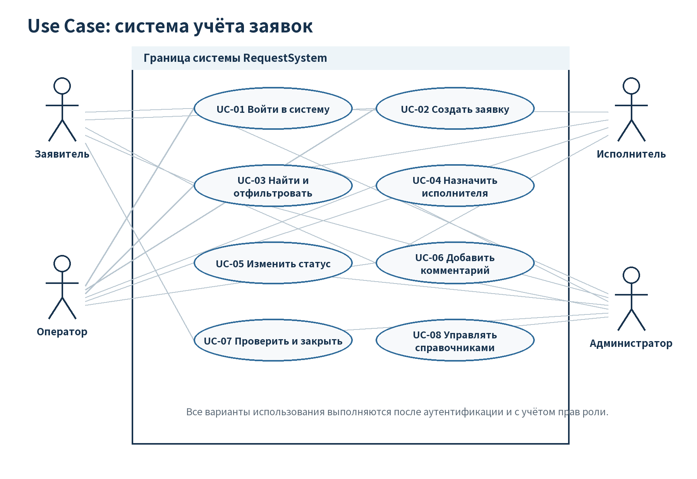

## 1. Назначение и проблема

**Цель работы:** научиться переводить исходную задачу в формализованные требования к программной системе.

Система учёта заявок создаётся для регистрации обращений, назначения исполнителя и контроля выполнения. Без неё сведения распределяются между сообщениями, почтой и устными договорённостями. Сложно установить ответственного, текущее состояние и историю обращения. Возможны потеря заявки, повторная регистрация и закрытие без подтверждения результата.

Программа формирует единый реестр, автоматически присваивает номер, ограничивает действия по ролям и сохраняет историю. Заявитель контролирует свои обращения, оператор распределяет работу, исполнитель выполняет назначенные задачи, администратор управляет системой.

| Роль | Разрешённые действия | Основное ограничение |
|---|---|---|
| Заявитель | Создаёт и комментирует заявки, проверяет результат, закрывает выполненную заявку | Видит только свои заявки |
| Оператор | Регистрирует и уточняет обращения, назначает исполнителя, переводит новую заявку в работу | Не управляет ролями |
| Исполнитель | Работает с назначенными заявками, комментирует, отмечает выполнение | Не закрывает заявку и не назначает других |
| Администратор | Управляет пользователями и справочниками, выполняет действия оператора, закрывает заявки | Действия фиксируются, связанные записи защищены |

Выделены сущности: пользователь, роль, заявка, статус, категория, комментарий, история изменения и перспективное вложение.

<!-- pagebreak -->
## 2. Функциональные требования

| ID | Система должна… |
|---|---|
| FR-01 | Аутентифицировать пользователя и определять его роль перед предоставлением функций. |
| FR-02 | Позволять заявителю и оператору создавать заявку с темой, описанием и категорией. |
| FR-03 | Автоматически присваивать уникальный номер `REQ-ГГГГ-NNNNN`. |
| FR-04 | Показывать список с учётом роли: свои, назначенные или все заявки. |
| FR-05 | Обеспечивать поиск по номеру/теме и фильтры по статусу/категории. |
| FR-06 | Показывать карточку с полными сведениями, комментариями и историей. |
| FR-07 | Позволять оператору и администратору назначать и менять исполнителя. |
| FR-08 | Поддерживать 4 статуса и запрещать непредусмотренные переходы. |
| FR-09 | Сохранять историю статуса и исполнителя без перезаписи прошлых записей. |
| FR-10 | Позволять участникам добавлять комментарии с автором и временем. |
| FR-11 | Поддерживать не менее 4 категорий и их администрирование. |
| FR-12 | Позволять заявителю-владельцу и администратору закрыть выполненную заявку. |
| FR-13 | Позволять администратору управлять учётными записями и ролями. |
| FR-14 | Проверять обязательные поля и сохранять введённые данные после ошибки. |
| FR-15 | Требовать подтверждение необратимых действий и ограничивать удаление связанных записей. |

**Допустимые переходы:** «Новая» → «В работе» после назначения; «В работе» → «Выполнена» исполнителем; «Выполнена» → «В работе» для доработки; «Выполнена» → «Закрыта» после проверки. Закрытая заявка не изменяется.

<!-- pagebreak -->
## 3. Нефункциональные требования и сущности

| ID | Проверяемое требование |
|---|---|
| NFR-01 | Русскоязычный интерфейс; создание доступно из главного экрана не более чем за 3 действия. |
| NFR-02 | 95 % запросов списка и карточки — не более 2 секунд при 50 пользователях и 10 000 заявок. |
| NFR-03 | Статус и история изменяются в одной транзакции; при ошибке обе операции отменяются. |
| NFR-04 | Пароли хешируются, права проверяются на сервере, секреты исключаются из Git. |
| NFR-05 | Код разделяется на controller, service, repository и data; бизнес-правила не зависят от UI. |
| NFR-06 | База использует PK, FK, `NOT NULL`, `UNIQUE` и ограничения удаления. |
| NFR-07 | Прототип корректно отображается в актуальных Chrome и Edge при ширине от 1280 px. |
| NFR-08 | Ключевые правила и SQL-ограничения имеют повторяемые автотесты. |

| Сущность | Атрибуты и связь |
|---|---|
| Пользователь | Имя, логин, хеш, роль, активность; заявитель или исполнитель |
| Роль | Уникальное название и права пользователя |
| Заявка | Номер, тема, описание, даты, категория, статус, участники |
| Статус | Справочник из 4 состояний жизненного цикла |
| Категория | Справочник типов обращений, не менее 4 записей |
| Комментарий | Текст, автор, время, ссылка на заявку |
| История | Старые и новые значения, автор и дата изменения |
| Вложение | Перспективное расширение, не входит в минимальную SQL-версию |

<!-- pagebreak -->
## 4. Сценарии использования

Диаграмма охватывает 8 сценариев: UC-01 вход; UC-02 создание; UC-03 поиск и фильтрация; UC-04 назначение; UC-05 смена статуса; UC-06 комментирование; UC-07 проверка и закрытие; UC-08 администрирование справочников.

В UC-02 система проверяет поля, присваивает номер и статус «Новая». При ошибке данные не теряются. В UC-03 пустой результат предлагает сброс фильтров. В UC-05 недопустимый переход отклоняется. В UC-07 закрытие возможно только после выполнения. Все сценарии согласованы с ролями и диаграммой.

<!-- pagebreak -->
## 5. Приёмка и сравнение промптов

| ID | Критерий готовности |
|---|---|
| AC-01 | Четыре роли получают только разрешённые функции; чужая заявка недоступна. |
| AC-02 | Новая заявка получает уникальный номер, дату и статус «Новая». |
| AC-03 | Пустые обязательные поля не сохраняются; остальной ввод не теряется. |
| AC-04 | Поиск и совместные фильтры возвращают корректный набор; сброс работает. |
| AC-05 | Назначение отображается в карточке и создаёт запись истории. |
| AC-06 | Разрешённые переходы выполняются, недопустимые отклоняются. |
| AC-07 | История хранит прежнее/новое значение, автора и дату. |
| AC-08 | Непустой комментарий сохраняется, пустой отклоняется. |
| AC-09 | Существуют не менее 4 категорий, дубликат отклоняется. |
| AC-10 | Схема и тестовые SQL-скрипты выполняются на пустой базе без ошибок. |
| AC-11 | Прототип содержит не менее 5 экранов, ошибки и подтверждение удаления. |
| AC-12 | ТЗ, диаграммы, UI, SQL, проверки и AI-журнал согласованы в репозитории. |

Свободный промпт дал общий список, но оставил «быстро», «удобно» и широкие права исполнителя. Структурированный промпт задал роль, контекст, количество элементов, формат FR/NFR/AC и ограничения. Он выбран, потому что результат полнее и проверяемее. Полные тексты находятся в `docs/lab1_prompt_comparison.md`.

<!-- pagebreak -->
## 6. Проверка результата и AI-журнал

**Модель:** Kimi (Kimi Work); точная версия интерфейсом не сообщается.  
**Задача ИИ:** выступить системным аналитиком и подготовить основу ТЗ.  
**Почему модель и промпт:** длинный контекст методички, русский язык, структурированный анализ; заданы роль, формат, ограничения и критерии качества.  
**Полный промпт и результат:** сохранены в `docs/ai_log.md` и `docs/lab1_prompt_comparison.md`.  
**Использовано:** роли, сущности, жизненный цикл, структура требований и критериев.

**Самостоятельная проверка и доработка:**

- FR-04: доступ заявителя ограничен собственными заявками на сервере, а не только скрытием кнопок.
- FR-08: общее право исполнителя менять статус заменено одним разрешённым переходом.
- NFR-02: «быстро» заменено измеримым порогом 2 секунд для 95 % запросов.
- NFR-03: статус и история связаны одной транзакцией.
- Диаграмма визуально проверена и соответствует 8 сценариям.

**Самопроверка:** противоречия устранены; каждая функция связана с ролью; требования имеют идентификаторы; критерии проверяемы; файлы сохранены в Git. Полное ТЗ находится в `docs/TZ.md`.

**Вывод:** я научился превращать описание задачи в формализованные требования и критерии приёмки. ИИ оказался полезен для чернового анализа, но двусмысленные права и неизмеримые пожелания потребовали самостоятельной доработки.
