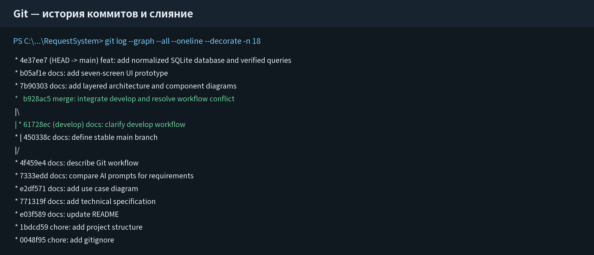
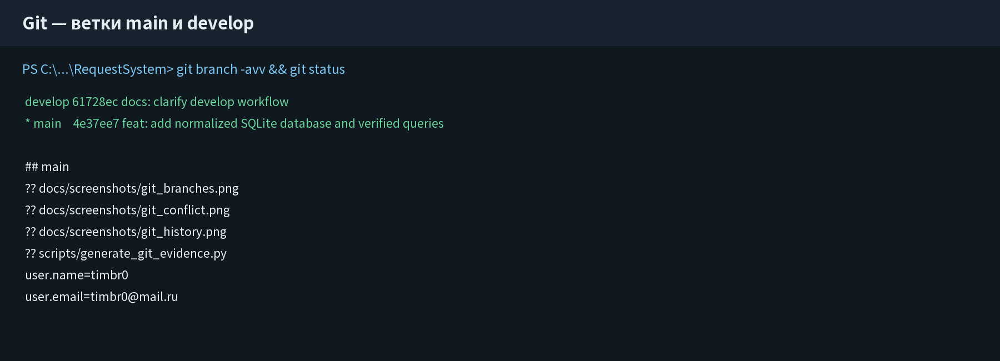
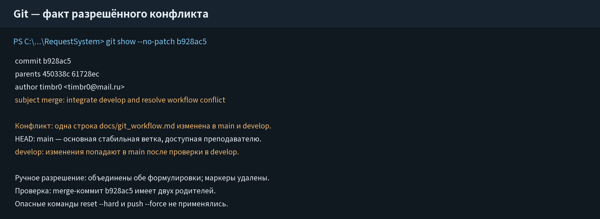

## 1. Цель и настройка репозитория

**Цель работы:** организовать разработку проекта с использованием Git.

Проверена версия `git version 2.47.1.windows.1`. Создан локальный репозиторий `Гатин_Тимофей_еозИСИП-308_RequestSystem` с основной веткой `main`. Автор настроен только внутри проекта:

```bash
git init -b main
git config user.name "timbr0"
git config user.email "timbr0@mail.ru"
```

Имя и e-mail являются подписью авторства коммитов, а не учётными данными для входа на GitHub. Созданы `README.md` и `.gitignore`. Игнорируются `.venv`, IDE, кэш Python, `.env`, ключи и локальные базы. Учебная `database/requests.db` явно включена, поскольку требуется лабораторной №5.

| Команда | Назначение |
|---|---|
| `git status` | Проверить состояние рабочего каталога |
| `git add <файл>` | Подготовить выбранные изменения |
| `git commit -m "..."` | Сохранить отдельный этап |
| `git switch -c develop` | Создать и открыть рабочую ветку |
| `git merge develop` | Слить develop в текущую main |
| `git log --graph --all` | Проверить историю и слияния |
| `git push -u origin main` | Отправить основную ветку после настройки URL |

Команды `reset --hard` и `push --force` не применялись, поскольку могут удалить изменения или перезаписать историю.

<!-- pagebreak -->
## 2. Коммиты и ветки

В истории более пяти осмысленных коммитов. Отдельно зафиксированы `.gitignore`, структура, README, ТЗ, Use Case, сравнение промптов, workflow, архитектура, интерфейс и база данных.



Ветка `develop` создана командой `git switch -c develop`. В ней изменено описание workflow и выполнен коммит `61728ec`. На `main` независимо изменён тот же фрагмент в коммите `450338c`, после чего выполнено слияние.



<!-- pagebreak -->
## 3. Конфликт и ручное разрешение

При `git merge develop` Git сообщил: `CONFLICT (content): Merge conflict in docs/git_workflow.md`. Причина — одна строка получила разные дополнения в двух ветках.

В `main` было указано, что это основная стабильная ветка, доступная преподавателю. В `develop` добавлено правило, что изменения попадают в `main` после проверки. Я открыл маркеры `<<<<<<< HEAD`, `=======`, `>>>>>>> develop` и вручную объединил обе формулировки. Автоматический выбор одной стороны удалил бы полезное правило.



После редактирования файл добавлен через `git add`, создан merge-коммит `b928ac5`. Проверка показывает двух родителей: `450338c` и `61728ec`. Рабочее дерево после фиксации материалов очищено.

<!-- pagebreak -->
## 4. AI-журнал и итог

**Модель:** Kimi (Kimi Work); версия не отображается.  
**Задача:** получить безопасный Git-workflow, команды, сообщения коммитов, `.gitignore` и способ разбора конфликта.  
**Промпт:** полный текст сохранён в `docs/ai_log.md`, раздел лабораторной №2.  
**Почему такой запрос:** требовались не только команды, но и риски `merge`, `reset`, `push --force`, а также локальная настройка автора.  
**Результат ИИ:** рекомендован workflow `main/develop`, префиксы сообщений и последовательность команд.

**Проверка:** все команды выполнены локально. Фактические ветки, конфликт, merge и авторство подтверждены снимками репозитория.

**Собственная доработка:** вместо `git checkout -b` использовано современное `git switch -c`; в `.gitignore` добавлено исключение для сдаваемой учебной базы; конфликт разрешён объединением смысла двух версий.

**Удалённый репозиторий:** https://github.com/t1mbr0/timbr0_RequestSystem. Репозиторий публичный; ветки `main` и `develop` отправлены на GitHub с сохранением истории коммитов и слияния.

**Вывод:** я научился сохранять работу отдельными этапами, использовать ветки и разрешать конфликт без потери полезных изменений. Команды ИИ оказались полезны только после проверки на фактической истории.
