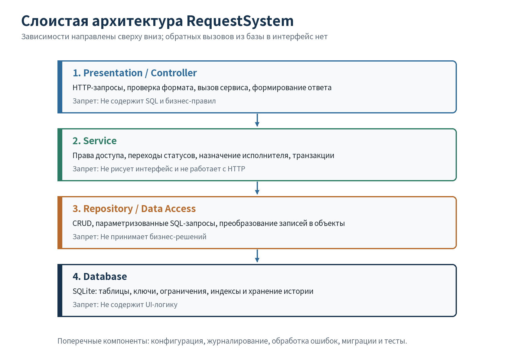
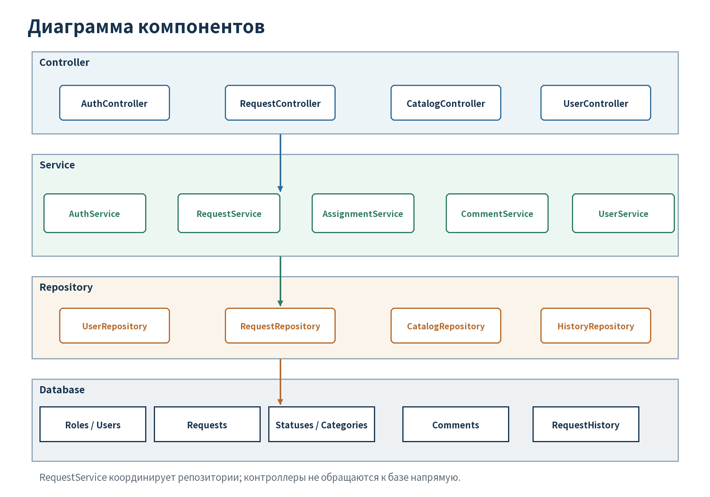

## 1. Выбор архитектуры

**Цель работы:** выделить слои, компоненты и границы ответственности системы.

| Критерий | Слоистая архитектура | Микросервисы |
|---|---|---|
| Простота | Одно приложение и база | Сетевые API и несколько развёртываний |
| Тестируемость | Сервисы проверяются без UI и SQL | Нужны сетевые интеграционные тесты |
| Расширяемость | Новые функции добавляются в слои | Независимое масштабирование |
| Стоимость | Низкая для учебного проекта | Высокая инфраструктурная сложность |
| Соответствие | Подходит небольшому проекту SQLite | Избыточна при текущих требованиях |

Выбран вариант `controller → service → repository → database`. Преимущества: понятные границы, тестирование бизнес-правил, отсутствие SQL в контроллерах и единая транзакция. Недостаток: при сильном росте системы модули сложнее масштабировать независимо. Этот недостаток менее значим, чем стоимость микросервисов.

<!-- pagebreak -->
## 2. Слои и ответственность

| Слой | Ответственность | Запрет |
|---|---|---|
| Controller | Принять запрос, проверить формат, вызвать сервис, вернуть ответ | SQL и бизнес-решения |
| Service | Права, статусы, назначение, транзакции | UI, HTTP и детали SQLite |
| Repository | CRUD, поиск, параметризованные запросы | Проверка ролей и выбор статуса |
| Database | Хранение, PK/FK, ограничения, индексы | UI-логика |

Зависимости направлены сверху вниз. Сервис зависит от интерфейса репозитория, а не от конкретного SQL. Доменные правила не зависят от контроллеров.

<!-- pagebreak -->
## 3. Компоненты и структура

Основные модули: пользователи, заявки, назначение, статусы, категории, комментарии и история. `RequestService` координирует `RequestRepository` и `HistoryRepository`.

| Модуль | Вход | Результат |
|---|---|---|
| `RequestController` | Данные формы/API, пользователь | Карточка или ошибка валидации |
| `RequestService` | Пользователь, заявка, изменения | Обновление и история в транзакции |
| `StatusService` | Текущий/новый статус, роль, владение | Разрешение и код причины отказа |
| `RequestRepository` | Объект или параметры поиска | Заявка или список |
| `HistoryRepository` | Старые/новые значения, автор | Новая запись или хронология |

Структура исходного кода разделена на `controllers`, `services`, `repositories`, `models`, `tests` и `database`.

<!-- pagebreak -->
## 4. Архитектурное ревью и проверка

**Модель:** Kimi (Kimi Work); версия не отображается. Полный промпт сравнения вариантов и ревью сохранён в `docs/ai_log.md`.

| Замечание ИИ | Решение | Итог |
|---|---|---|
| Контроллер координирует два репозитория | Принято | Координация перенесена в сервис |
| Права проверяются только в UI | Принято | Проверка назначена сервису |
| Все переходы хранятся в SQL-триггерах | Принято | Матрица вынесена в `StatusService` |
| Отдельный сервис каждой категории | Отклонено | Общий модуль справочников, нет дублирования |
| Перезапись истории | Отклонено | История только дополняется |

Правило переходов реализовано в `src/request_system/services/status_service.py`. Автотесты проверяют обязательное назначение, запрет чужого закрытия, работу только назначенного исполнителя и неизменность закрытой заявки. Все 5 тестов архитектурного правила пройдены.

**Вывод:** слоистая архитектура соответствует требованиям и остаётся простой для учебной реализации. Ревью ИИ помогло уточнить границы, но спорные рекомендации были отклонены после сопоставления с ТЗ.
