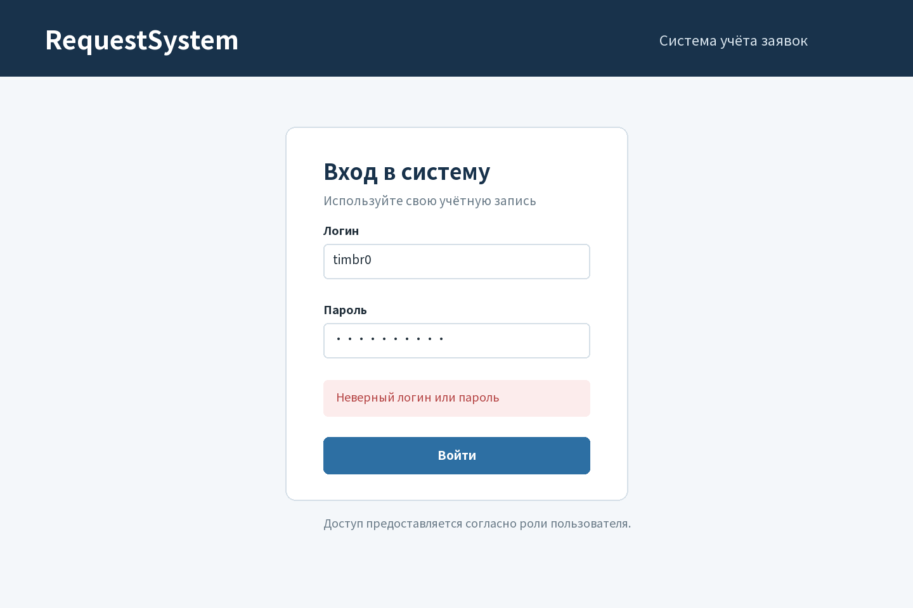
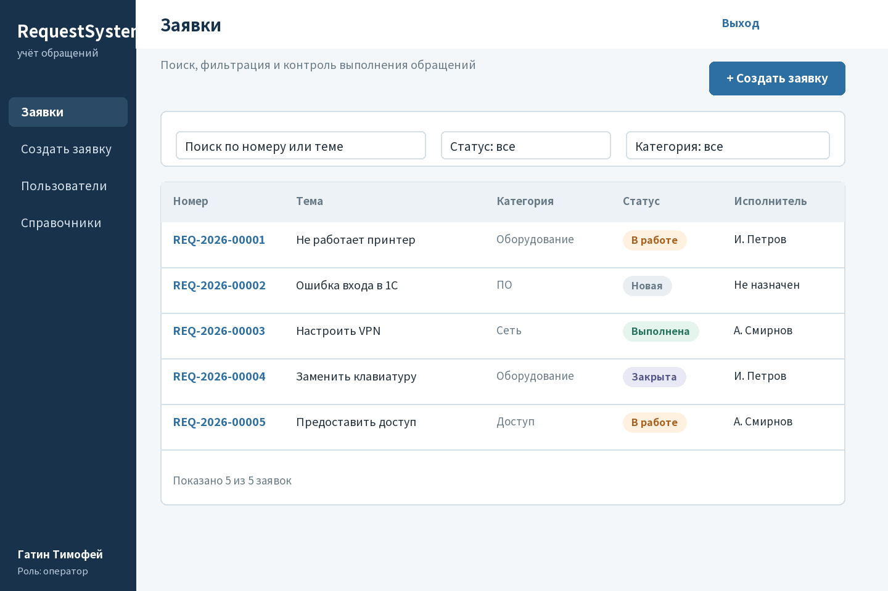
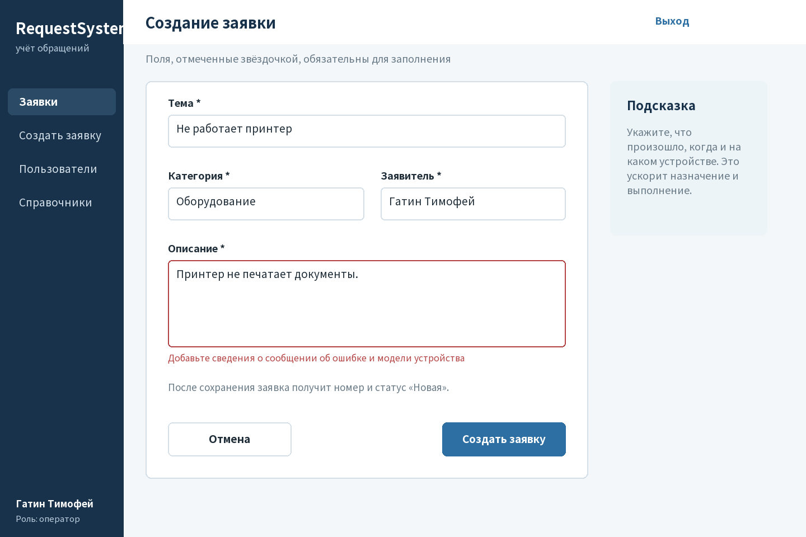
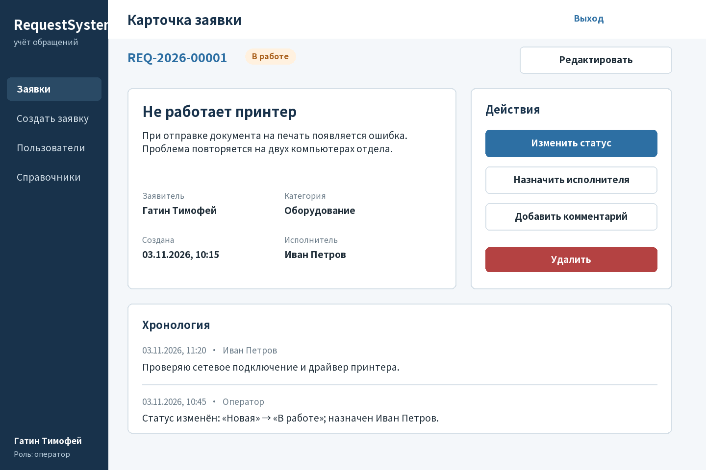
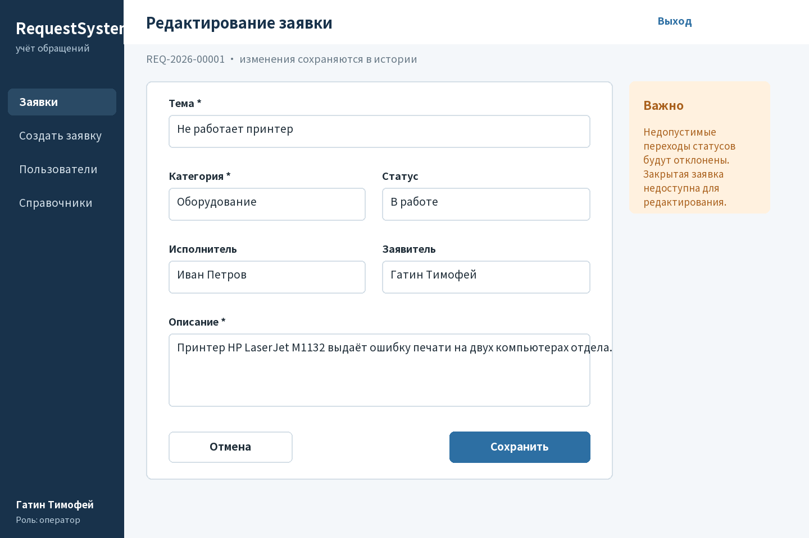
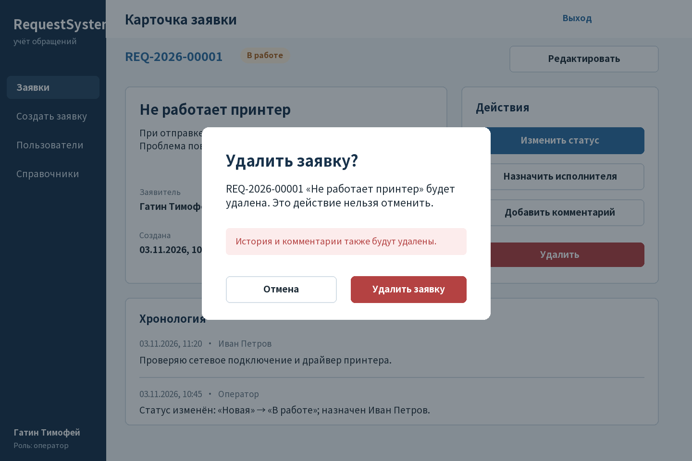
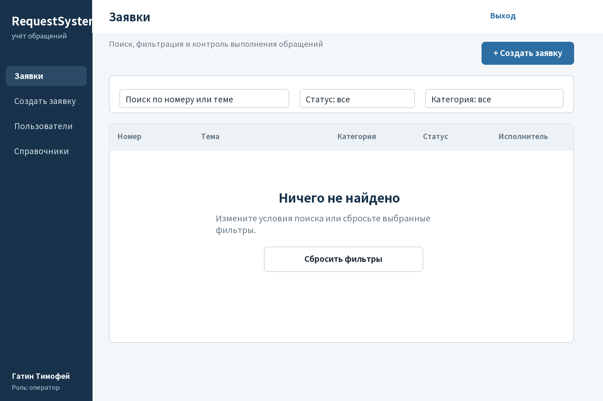

## 1. Подход и UX-чек-лист

**Цель работы:** разработать понятный прототип интерфейса до реализации экранов в коде.

Прототип основан на ролях и сценариях ТЗ. Проверялись: понятная навигация, обязательные поля, ошибки рядом с полем, сохранение ввода, поиск и совместные фильтры, текстовые статусы, пустые состояния, история, подтверждение опасных действий и визуальная иерархия кнопок.

Создано 7 экранов. Основные действия выделены синим, второстепенные — белым, опасные — красным. Статус различим по тексту и цвету. Все изображения собраны в `docs/ui/prototype.pdf`.

| Экран | Назначение |
|---|---|
| Вход | Аутентификация и безопасное сообщение об ошибке |
| Список | Поиск, фильтрация, переход к созданию и карточке |
| Создание | Регистрация с валидацией и сохранением ввода |
| Карточка | Полные сведения, действия, комментарии и история |
| Редактирование | Изменение полей и разрешённого статуса |
| Удаление | Подтверждение необратимого действия |
| Пустой результат | Подсказка и сброс фильтров |

<!-- pagebreak -->
## 2. Экран входа

Пользователь вводит логин и пароль. Ошибка не раскрывает, какое именно значение неверно. После входа функции определяются ролью.

<!-- pagebreak -->
## 3. Главный экран

Список содержит номер, тему, категорию, статус и исполнителя. Поиск и фильтры расположены над данными. Кнопка создания доступна из главного экрана.

<!-- pagebreak -->
## 4. Создание заявки

Обязательные поля отмечены. Ошибка находится под описанием, введённые данные сохраняются. Подсказка объясняет, какие сведения ускорят обработку.

<!-- pagebreak -->
## 5. Карточка заявки

Карточка объединяет описание, участников, статус, действия и хронологию. Наложение подписи, найденное при визуальной проверке, исправлено.

<!-- pagebreak -->
## 6. Редактирование

Форма сохраняет контекст номера и показывает предупреждение о допустимых переходах. Закрытая заявка не редактируется.

<!-- pagebreak -->
## 7. Подтверждение удаления

Перед удалением показаны номер заявки и последствия для истории и комментариев. Отмена визуально отделена от опасного действия.

<!-- pagebreak -->
## 8. Пустое состояние и AI-ревью

**Модель:** Kimi (Kimi Work); версия не отображается. Полный UX-промпт сохранён в `docs/ai_log.md`.

| Замечание ИИ | Моё решение и результат |
|---|---|
| Статус нельзя обозначать только цветом | Принято: добавлен текст маркера |
| Нужен следующий шаг при пустом поиске | Принято: экран и сброс фильтров |
| Ошибка должна быть у поля | Принято: сообщение под описанием |
| Удаление требует защиты | Принято: модальное подтверждение |
| Добавить декоративный фон | Отклонено: нет пользы для сценариев |

**Вывод:** прототип покрывает создание, просмотр и редактирование, ошибки и пустые состояния. Все 7 экранов и PDF визуально проверены.
