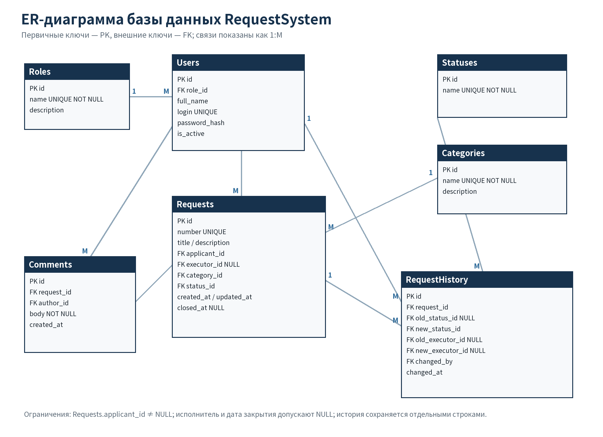
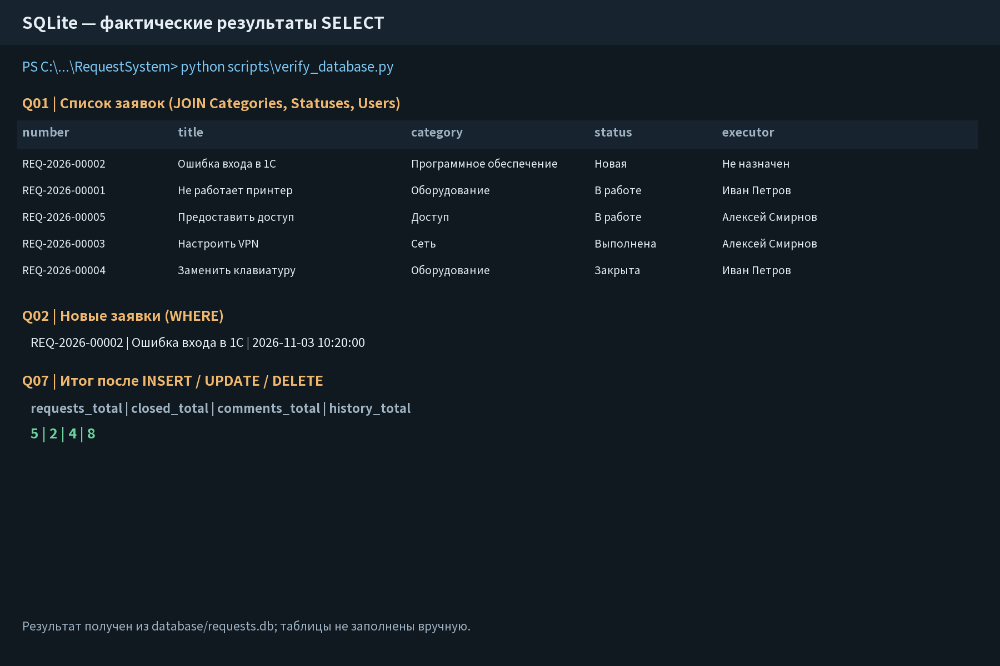
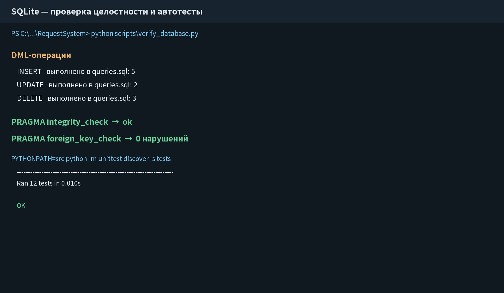

## 1. Цель и ER-модель

**Цель работы:** перейти от модели предметной области к реляционной базе и SQL-запросам.

Созданы 7 таблиц: `Roles`, `Users`, `Statuses`, `Categories`, `Requests`, `Comments`, `RequestHistory`. Основная заявка ссылается на заявителя, необязательного исполнителя, категорию и статус. Комментарии и история хранятся отдельно.

Связи 1:M: роль → пользователи; пользователь → заявки; категория/статус → заявки; заявка → комментарии и история. M:M не требуется, поскольку у заявки один текущий исполнитель и одна категория.

<!-- pagebreak -->
## 2. Нормализация и ограничения

| Таблица | PK | Основные ограничения и FK |
|---|---|---|
| `Roles` | `id` | Уникальное `name` |
| `Users` | `id` | `role_id`, уникальный `login`, непустое имя, активность 0/1 |
| `Statuses` | `id` | Уникальное название из 4 допустимых |
| `Categories` | `id` | Уникальное непустое название |
| `Requests` | `id` | Уникальный номер, обязательные поля, FK участников и справочников |
| `Comments` | `id` | FK заявки/автора, непустой текст |
| `RequestHistory` | `id` | FK заявки, старых/новых значений и автора |

База соответствует 1НФ благодаря атомарным полям, 2НФ — зависимости атрибутов от простого PK, 3НФ — выносу повторяющихся названий в справочники. История фиксирует события и не является вредным дублированием.

Использованы `NOT NULL`, `UNIQUE`, `CHECK` и индексы. `RESTRICT` защищает используемые справочники, `SET NULL` допускает удаление исполнителя, `CASCADE` удаляет комментарии и историю вместе с заявкой. Схема создаётся с нуля файлом `database/schema.sql`.

<!-- pagebreak -->
## 3. SQL-запросы и фактические результаты

`seed.sql` создаёт 4 роли, 6 пользователей, 4 статуса, 5 категорий и 5 заявок. `queries.sql` содержит 7 `SELECT`, 5 дополнительных `INSERT`, 2 `UPDATE` и 3 `DELETE`. Есть более 3 `WHERE`, 5 `JOIN`, `GROUP BY`, `HAVING`, `LIKE` и подзапросы.

Q01 объединяет заявки со справочниками и исполнителем. Q02 выбирает новые заявки. Q03 применяет два условия. Q04 считает комментарии. Q05 ищет по номеру и теме. Q06 показывает историю. Q07 фиксирует итог после DML.

Полные результаты каждого SELECT сохранены в `docs/database/query_results.md`.

<!-- pagebreak -->
## 4. Проверка и собственная доработка

База пересоздана скриптом `python scripts/verify_database.py`. `PRAGMA integrity_check` вернул `ok`, `foreign_key_check` — 0 нарушений. Все 12 автотестов проекта пройдены. Отдельно проверены уникальность логина, запрет пустого комментария, FK и невозможность удаления используемой категории.

**AI-журнал:** использована Kimi (Kimi Work), версия не отображается. Полный промпт ER и SQL сохранён в `docs/ai_log.md`.

**Собственная доработка:** текстовые статус и категория из черновика заменены FK; добавлены `CHECK`, правила удаления и история исполнителя. В закрытие добавлено условие `WHERE id = 3 AND status_id = 3`, чтобы исключить обновление из неподходящего состояния. Временные записи удалены после проверки.

**Вывод:** я научился проектировать нормализованную SQLite-базу и проверять SQL на реальных данных. Ответ ИИ использован как черновик, а корректность подтверждена выполнением и тестами.
