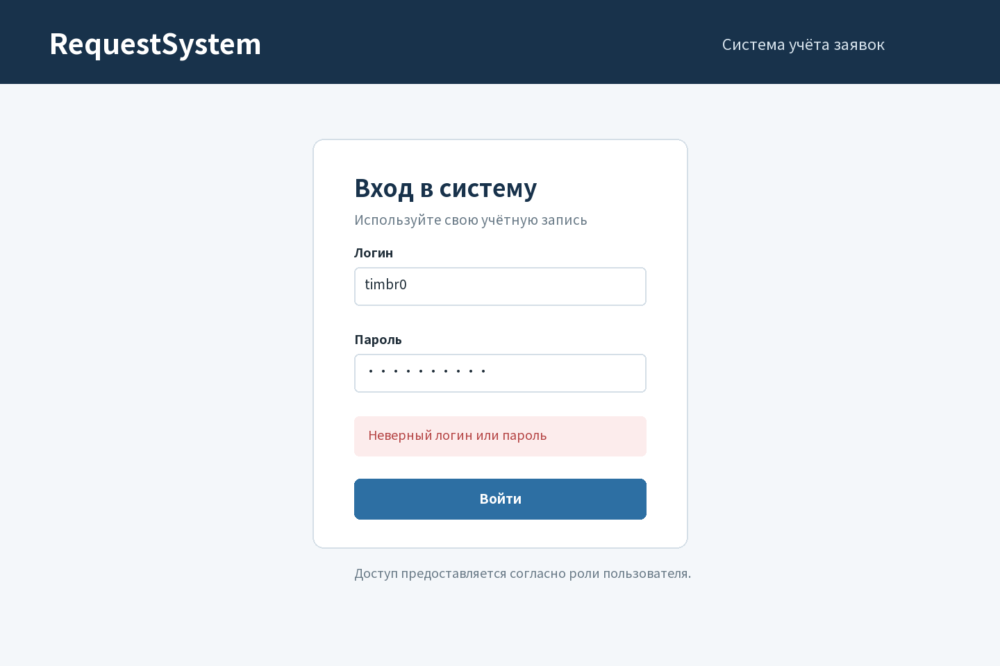
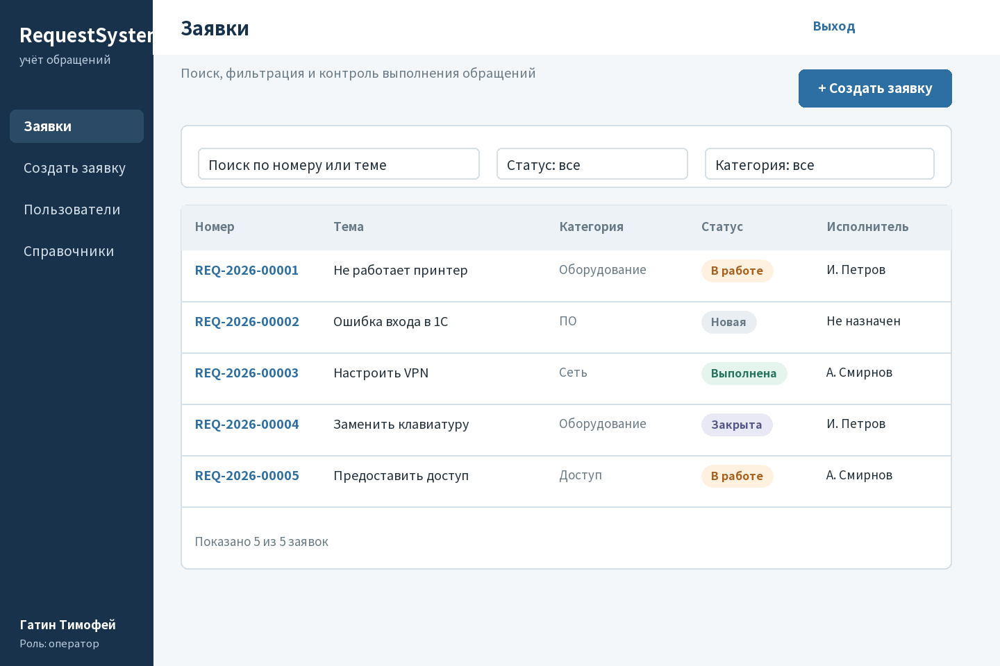
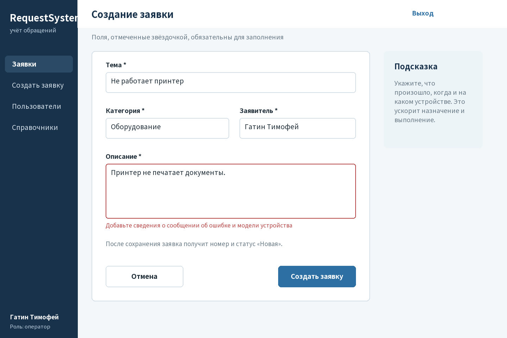
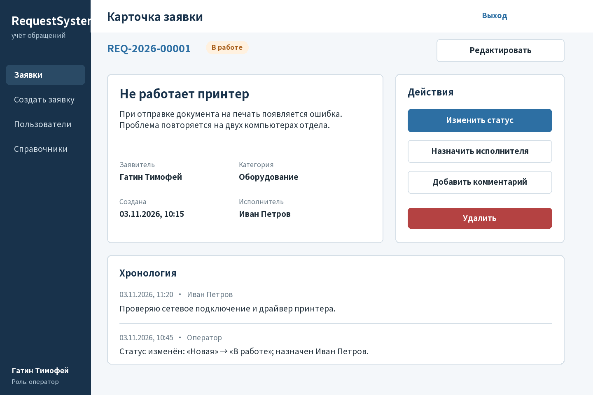
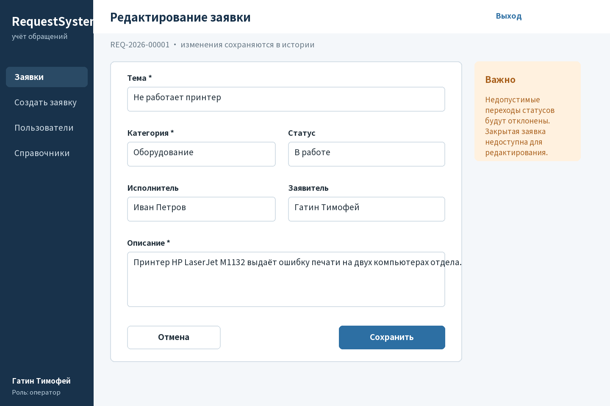
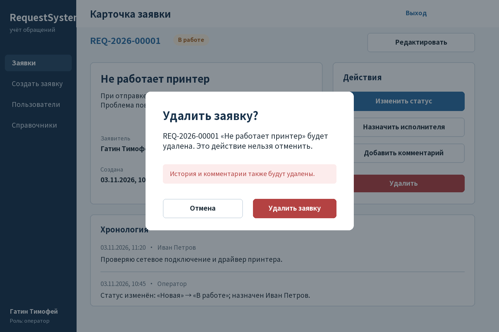
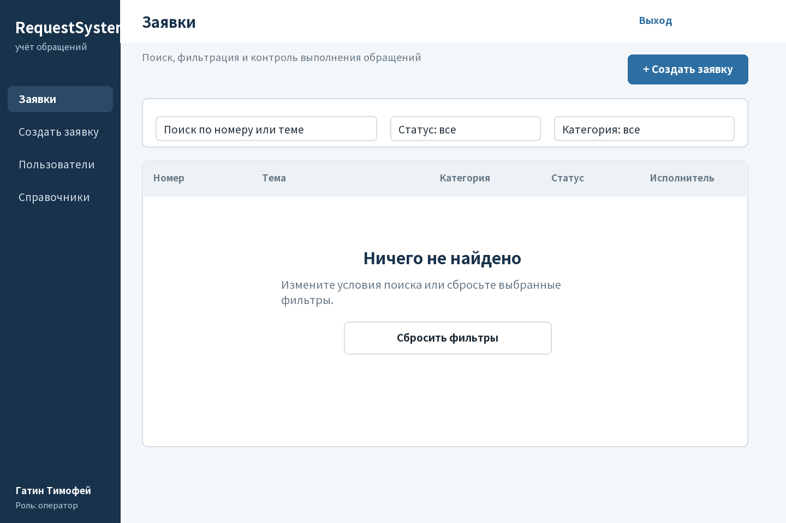

# Прототип пользовательского интерфейса RequestSystem

**Студент:** Гатин Тимофей, еозИСИП-308  
**Формат:** 7 экранов PNG и общий файл `prototype.pdf`.  
**Основа:** роли и сценарии из `docs/TZ.md`.

## 1. UX-чек-лист

Перед проектированием я использовал следующий чек-лист:

- основная навигация и следующее действие понятны на каждом экране;
- обязательные поля отмечены, ошибка расположена рядом с полем;
- введённые данные не исчезают после ошибки;
- список поддерживает поиск, совместную фильтрацию и сброс условий;
- статус различим не только по цвету, но и по тексту;
- пустой результат поиска объясняет, что делать дальше;
- карточка содержит исполнителя, заявителя, описание, комментарии и историю;
- опасное действие требует отдельного подтверждения;
- основные кнопки визуально отличаются от второстепенных;
- роли получают только разрешённые им действия;
- контраст текста достаточен, размеры элементов одинаковы на всех экранах.

## 2. Экраны и доступные действия

| Экран | Назначение | Действия пользователя |
|---|---|---|
| `01_login.png` | Аутентификация и пример ошибки входа | Ввести логин и пароль, войти, исправить данные после сообщения |
| `02_requests_list.png` | Главный список заявок | Искать по номеру и теме, фильтровать по статусу и категории, открыть заявку, перейти к созданию |
| `03_create_request.png` | Регистрация обращения | Заполнить тему, категорию, заявителя и описание; увидеть ошибку без потери данных; отменить или создать |
| `04_request_details.png` | Просмотр полной информации | Изменить статус, назначить исполнителя, комментировать, редактировать, перейти к удалению |
| `05_edit_request.png` | Изменение существующей заявки | Исправить поля, выбрать разрешённый статус и исполнителя, сохранить или отменить |
| `06_delete_confirmation.png` | Защита от случайного удаления | Прочитать последствия, отменить или подтвердить необратимое действие |
| `07_empty_state.png` | Отсутствие результатов поиска | Изменить условия или сбросить фильтры одним действием |

## 3. Ключевые изображения

### Вход

### Список заявок

### Создание заявки

### Карточка заявки

### Редактирование

### Подтверждение удаления

### Пустое состояние

## 4. Критическая оценка прототипа с ИИ

**Модель:** Kimi (Kimi Work); точная версия интерфейсом не сообщается.

**Полный промпт:**

> Выступи UX-ревьюером. Критически оцени прототип системы учёта заявок по чек-листу: навигация, формы, ошибки, пустые состояния, фильтрация, доступность, понятность статусов и подтверждение опасных действий. Есть экраны входа, списка, создания, карточки, редактирования, удаления и пустого результата. В списке ищут по номеру/теме и фильтруют по статусу/категории; статус имеет текст и цвет. В создании обязательные поля отмечены, ошибка стоит под описанием, введённый текст сохраняется. Дай минимум пять конкретных замечаний. Для каждого укажи проблему, риск для пользователя и исправление. Не предлагай декоративные изменения без пользы для сценариев.

| Замечание ИИ | Моё решение | Результат в прототипе |
|---|---|---|
| Цветового статуса недостаточно для пользователей с нарушениями цветоразличения | **Принято** | Все статусы подписаны текстом внутри цветного маркера |
| Пустой список без подсказки заставляет пользователя догадываться о следующем шаге | **Принято / исправлено** | Добавлен экран `07_empty_state.png` с кнопкой «Сбросить фильтры» |
| Ошибка только вверху формы не показывает проблемное поле | **Принято / исправлено** | Сообщение размещено непосредственно под описанием, поле выделено, введённые данные сохранены |
| Удаление одним нажатием может привести к потере истории | **Принято / исправлено** | Добавлено модальное подтверждение с номером заявки и предупреждением о последствиях |
| Одинаковый акцент всех кнопок затрудняет выбор основного действия | **Принято / исправлено** | Основные действия синие, второстепенные белые, опасное действие красное |
| Добавить анимированный фон и декоративные иконки | **Отклонено** | Это не улучшает сценарии и может снижать читаемость учебного прототипа |
| Показывать исполнителю кнопку администрирования, но блокировать её после нажатия | **Отклонено** | Недоступные роли действия не должны отображаться; права проверяются также на сервере |

## 5. Собственная проверка после доработки

- Сценарий «вход → список → создание → карточка» имеет понятные переходы.
- Сценарий «список → карточка → редактирование → сохранение» сохраняет контекст номера заявки.
- Ошибки входа и валидации написаны на русском языке и не раскрывают, какое именно поле входа неверно.
- Поиск и фильтры находятся над списком, а пустой результат содержит действие восстановления.
- Карточка показывает статус текстом, исполнителя, комментарии и историю.
- Удаление требует подтверждения и явно предупреждает о необратимости.
- Все семь PNG визуально проверены; обнаруженное наложение подписи на карточке заявки исправлено до формирования итогового PDF.

## 6. Вывод

Прототип соответствует требованиям лабораторной и основным ролям. Он не выдаётся за работающее приложение: это проект экранов до реализации. Нейросеть помогла найти пропущенные состояния и проверить понятность действий, а окончательные решения были сопоставлены с ТЗ и сценариями пользователей.
